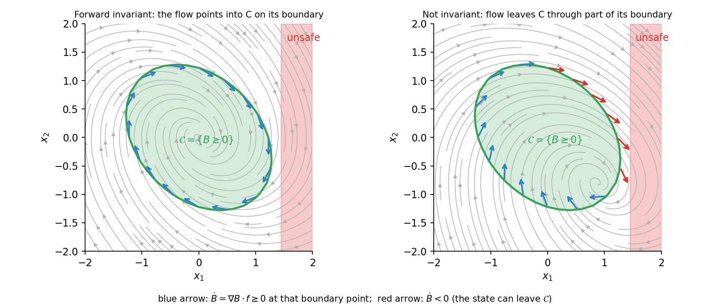
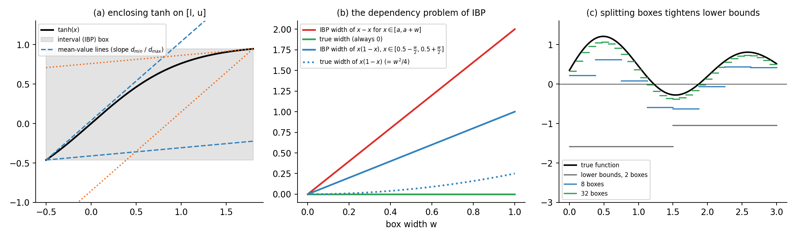
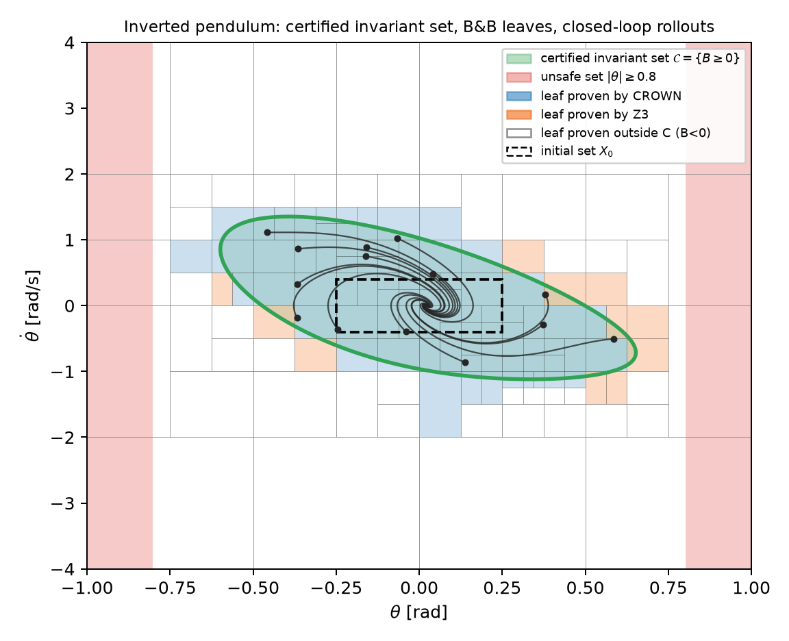
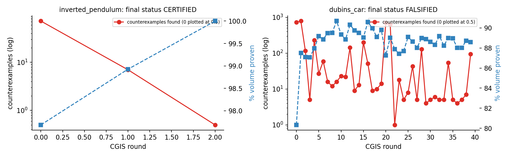
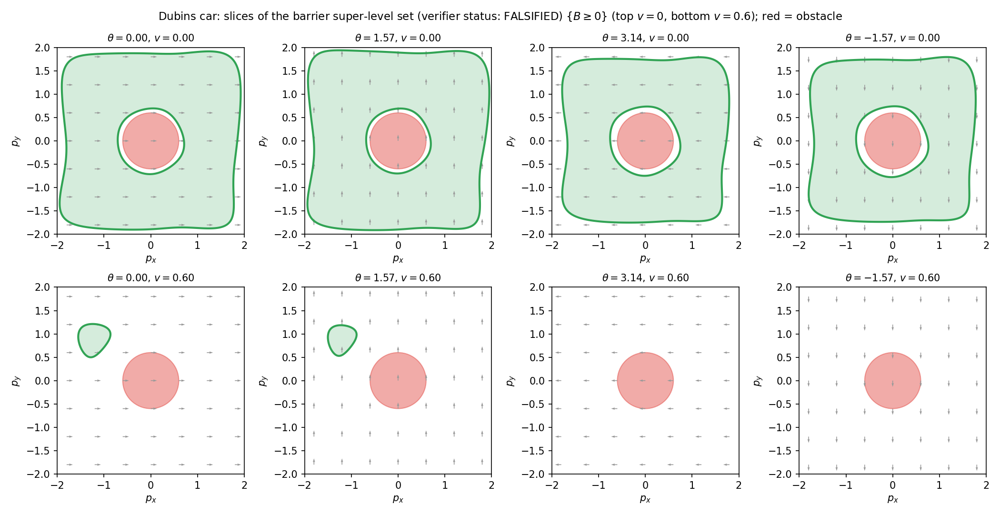

# How to read this guide

This guide assumes **no prior knowledge** of the project. It starts from ordinary
calculus and Python and builds up, one idea at a time, to the full verification
pipeline. Every concept is introduced in the same four steps:

1. **Intuition**: what the idea is, in plain words.
2. **Theory**: the precise mathematics.
3. **Code**: where the idea lives in the repository, with the relevant excerpt.
4. **Why**: why the project uses this idea rather than an alternative.

If you already know a topic, skip its section. The dependency order is:

```
Part I  Foundations      dynamics -> control -> safety sets -> barrier functions -> neural nets -> autodiff
Part II Verification     soundness -> intervals -> linear relaxation (CROWN) -> SMT/Z3 -> branch & bound -> proof checking
Part III Synthesis       losses -> training tricks -> the CGIS loop
Part IV Engineering      repository tour, configuration, commands, tests, dashboard
Part V  Results          what was proven, what failed, and why
Appendix                 glossary, cheat-sheet, FAQ, exercises
```

**The one-sentence summary of the project.** CertiControl-NN trains two small
neural networks: a *controller* that decides what to do, and a *barrier function*
that describes a region of states. It then uses mathematically rigorous
computation to **prove** that the controller never lets the system leave that
region, for every one of the infinitely many possible states. When the proof
fails, the tool finds a concrete state where it fails and uses that state to
retrain the networks.

---

# The problem: why testing is not enough

Imagine a self-driving car whose steering is chosen by a neural network. You
simulate 10 000 drives and none crash. Is the network safe?

Not necessarily. The state of a car (position, heading, speed, ...) is a vector
of real numbers, so there are **uncountably many** possible states. A finite set
of simulations visits a set of measure zero. A small, badly behaved region can
hide between the samples.

This project demonstrates exactly that (Part V). For the Dubins car:

| check | what it saw |
|---|---|
| 2 000 000 uniformly random states | only **23** states violate the safety condition (rate about $10^{-5}$) |
| 100 simulated drives from safe states | **0** drives leave the safe region |
| formal verifier | **524** concrete violating states found; the proof is refused |
| simulations started *at the verifier's counterexamples* | **41 of 50** leave the safe region |

Testing said "safe". The verifier said "no, and here is where". That gap is the
reason formal verification exists.

**What "prove" means here.** We will compute an **over-approximation**: a set
that is guaranteed to contain every value a function can take on a region. If
even the over-approximation satisfies the safety inequality, the true function
must satisfy it too. No sampling is involved, so no region can be missed.

---

# Part I — Foundations

## Dynamical systems

### Intuition

A *dynamical system* is anything whose future is determined by its present
state and the rules of motion. The **state** $x$ is the smallest set of numbers
that fully describes the system at one instant.

* Pendulum: angle $\theta$ and angular velocity $\dot\theta$, so $x=(\theta,\dot\theta)\in\mathbb R^2$.
* Car: position $(p_x,p_y)$, heading $\theta$ and speed $v$, so $x\in\mathbb R^4$.

### Theory: ordinary differential equations (ODEs)

In continuous time, the rules of motion are an ODE:
$$\dot x(t)=\frac{dx}{dt}=F(x(t)).$$
$F:\mathbb R^n\to\mathbb R^n$ is the **vector field**. At every state it gives the
direction and speed of motion. A **trajectory** is a solution $x(t)$ that starts
from an initial state $x(0)=x_0$. If $F$ is Lipschitz continuous (roughly: it
does not change infinitely fast), the solution exists and is unique for a
while (the Picard–Lindelöf theorem).

### Control inputs and the control-affine form

A **controlled** system has an input $u\in\mathbb R^m$ that we choose: a motor
torque, a steering rate, an acceleration. Many physical systems are
**control-affine**, meaning the input enters linearly:
$$\dot x = f(x) + g(x)\,u .$$
Here $f(x)$ is the *drift* (what happens with zero input) and $g(x)$ is an
$n\times m$ matrix saying how each input pushes each state.

**Why control-affine?** Two reasons. It is the standard setting of control
barrier function theory, where for fixed $x$ the derivative $\dot B$ is linear
in $u$. It also keeps the closed-loop computation simple enough to bound
tightly.

Actuators are limited, so $u_{\min}\le u\le u_{\max}$ componentwise. Ignoring
these limits is a classic source of "proofs" that fail on real hardware. This
project enforces them by construction (see the section on neural controllers below).

### The two systems in this project

**Inverted pendulum** (`InvertedPendulum`, 2 states, 1 input). With $\theta=0$
upright:
$$\dot\theta=\omega,\qquad \dot\omega=\frac{g}{l}\sin\theta-\frac{b}{ml^2}\,\omega+\frac{1}{ml^2}\,u,\qquad |u|\le 6.$$
Gravity pulls the pendulum away from upright with strength $\frac gl\sin\theta$.
The torque can resist only up to $6$. Since $9.81\sin\theta>6$ as soon as
$\theta>0.66$, beyond about 0.66 rad no controller can stop the fall. The
**unsafe set** is $|\theta|\ge 0.8$. The *real* limit, though, is the torque
bound, not the unsafe set. This makes the problem non-trivial: the safe region
must be discovered, not just copied from the specification.

**Dubins car with acceleration** (`DubinsCar`, 4 states, 2 inputs):
$$\dot p_x=v\cos\theta,\quad \dot p_y=v\sin\theta,\quad \dot\theta=u_1,\quad \dot v=u_2,\qquad |u_1|\le2,\ |u_2|\le2 .$$
The car can turn ($u_1$) and speed up or brake ($u_2$). There is a circular
obstacle of radius 0.6 at the origin, and there are walls at $|p_x|=2$ and
$|p_y|=2$.

### Code

`src/dynamics/continuous_system.py`

```python
class InvertedPendulum(ControlAffineSystem):
    def xdot(self, x, u):
        th, om = x[:, 0:1], x[:, 1:2]
        ml2 = self.m * self.l ** 2
        dom = (self.grav / self.l) * ops.sin(th) + (-self.b / ml2) * om + (1.0 / ml2) * u[:, 0:1]
        return ops.cat([om, dom])
```

Notice `ops.sin` and `ops.cat` instead of `torch.sin` and `torch.cat`. This small
detail is central to the design and is explained in the section on the
single-source computation graph. `x` always has shape `(N, n)`: a batch of `N`
states. Batching lets thousands of states or boxes be processed at once.

`f(x)` and `g(x)` are not written separately. They are *derived* from `xdot`:
$f(x)=\texttt{xdot}(x,0)$, and column $j$ of $g$ is $\texttt{xdot}(x,e_j)-f(x)$.
Defining the dynamics once removes any chance that the two copies disagree.

### Simulating trajectories (numerical integration)

To draw trajectories and run empirical checks, the ODE is integrated
numerically with `scipy.integrate.solve_ivp` (method RK45, an adaptive
Runge–Kutta scheme). See `simulate()` in `src/visualization/phase_portrait.py`.
Simulation is used only for *illustration and cross-checking*, never as part of
a proof.

---

## Feedback control and the neural controller

### Intuition

A **feedback controller** (or *policy*) is a function $u=\pi(x)$: look at the
state, decide the input. Plugging it into the dynamics gives the
**closed-loop system**
$$\dot x=f(x)+g(x)\,\pi(x)=:F_{cl}(x),$$
which no longer has a free input. It is just an ODE that we can analyse.

### The neural controller

$$\pi_\theta(x)=u_{\rm mid}+u_{\rm half}\odot\tanh\big(\mathrm{MLP}_\theta(\psi(x))\big),
\qquad u_{\rm mid}=\tfrac{u_{\max}+u_{\min}}{2},\ u_{\rm half}=\tfrac{u_{\max}-u_{\min}}{2}.$$

* $\mathrm{MLP}_\theta$ is a multilayer perceptron (defined in the next section) with weights $\theta$.
* $\psi(x)$ is a *feature map* (explained below).
* $\tanh$ maps any real number into $(-1,1)$. After scaling and shifting, the output lies in $(u_{\min},u_{\max})$.

**Why squash with tanh?** It makes the actuator limits hold **by construction**
for every input, so they need no verification. It is also smooth, and it has
tight known bounds, which helps the verifier (Part II).

`src/models/neural_controller.py`

```python
def forward(self, s):
    out = mlp_forward(self.layers, s)[0]
    return ops.scale_shift(ops.tanh(out), self.u_half, self.u_mid)
```

---

## Safety as set invariance

### Intuition

Safety requirements usually read "never enter the bad region". A powerful
reformulation is: find a **good region $\mathcal C$** that

1. contains the starting states,
2. does not touch the bad region, and
3. can never be left: once inside, you stay inside forever.

Property 3 is called **forward invariance**. If all three hold, safety follows
immediately. The problem of reasoning about infinitely long trajectories
becomes a problem about the **boundary** of $\mathcal C$: check, at every
boundary point, that the flow points inward.



### Theory: sets as level sets, and Nagumo's theorem

Describe $\mathcal C$ by a scalar function $B:\mathbb R^n\to\mathbb R$:
$$\mathcal C=\{x: B(x)\ge 0\},\qquad \partial\mathcal C\approx\{x:B(x)=0\}.$$
Along a trajectory, the rate of change of $B$ follows from the chain rule:
$$\dot B(x)=\frac{d}{dt}B(x(t))=\nabla B(x)\cdot \dot x=\nabla B(x)\cdot F_{cl}(x).$$
The quantity $\nabla B\cdot F$ is called the **Lie derivative** of $B$ along $F$,
written $L_FB$. **Nagumo's theorem (1942)**, informally: under mild regularity,
$\mathcal C$ is forward invariant if $\dot B\ge 0$ at every boundary point, that
is, if the flow never points outward.

### Barrier certificates and control barrier functions (CBF)

Checking "$\dot B\ge 0$ only where $B=0$" is fragile: the boundary is a thin set
and hard to hit exactly. The standard strengthening is
$$\dot B(x)\;\ge\;-\alpha\big(B(x)\big)\qquad\text{for all } x \text{ with } B(x)\ge0,$$
where $\alpha$ is a **class-$\mathcal K$ function**: continuous, strictly
increasing, with $\alpha(0)=0$. This project uses the linear choice
$\alpha(y)=\gamma y$ with $\gamma>0$.

The condition reads: *deep inside $\mathcal C$, $B$ may decrease, but more
slowly as the state approaches the boundary; on the boundary, it may not
decrease at all.*

When the controller is also designed, $B$ is called a **control barrier
function (CBF)**. When $B$ is a neural network, it is a **neural CBF (NCBF)**.

### Why the condition implies invariance (the comparison lemma)

Suppose $\dot B\ge-\gamma B$ holds whenever $B\ge 0$, and let $b(t)=B(x(t))$ with
$b(0)\ge0$. Then $\frac{d}{dt}\big(e^{\gamma t}b(t)\big)=e^{\gamma t}(\dot b+\gamma b)\ge 0$
as long as $b\ge0$. So $e^{\gamma t}b(t)\ge b(0)$, which gives
$b(t)\ge e^{-\gamma t}b(0)\ge 0$. The value of $B$ can approach zero but never
cross it. $\blacksquare$

**Why the $\gamma B$ term?** It gives slack inside $\mathcal C$, which makes the
condition much easier to satisfy and to verify. A useful consequence, used by
the dashboard: if the condition holds for $\gamma$, it holds for every
$\gamma'\ge\gamma$, because $\gamma'B\ge\gamma B$ when $B\ge 0$.

### The four certified properties

Define $\mathrm{cond}(x)=\nabla B(x)\cdot\big(f(x)+g(x)\pi(x)\big)+\gamma B(x)$ and
a bounded verification domain $D$ (a box). The project proves:

| name | statement | purpose |
|---|---|---|
| **P1** invariance | $\forall x\in D:\ B(x)\ge0\Rightarrow \mathrm{cond}(x)\ge0$ | the CBF condition |
| **P2** safety | $\forall x\in D\cap X_{\rm unsafe}:\ B(x)<0$ | $\mathcal C$ avoids the unsafe set |
| **P3** containment | $\forall x\in\partial D$ (non-periodic faces)$:\ B(x)<0$ | $\mathcal C$ lies strictly inside $D$, so the proof on $D$ is enough |
| **P0** non-triviality | $\forall x\in X_0:\ B(x)>0$ | the initial states lie in $\mathcal C$ |

**Theorem.** If P0–P3 hold, then every closed-loop trajectory that starts in
$X_0$ (or anywhere in $\mathcal C$) stays in $\mathcal C$ forever, and so never
reaches the unsafe set.

*Why each piece is needed:*

* **Without P3**, a trajectory could leave the box $D$, where nothing was checked, and come back somewhere unsafe.
* **Without P0**, the barrier $B(x)=-1$ satisfies P1–P3 trivially. The "safe set" is empty and the proof says nothing. This really happened during development: the training loop converged to exactly this vacuous certificate until P0 was added.
* **P1 is required only where $B\ge0$.** Outside $\mathcal C$ the condition is usually false (think of a pendulum already falling), and it does not need to hold there.

**Periodic coordinates.** The car's heading $\theta$ is an angle, so
$\theta=\pi$ and $\theta=-\pi$ are the same state. Treating
$[-\pi,\pi]$ as an interval with two faces would create fake boundaries. The
networks therefore see $(\cos\theta,\sin\theta)$ instead of $\theta$, and the
$\theta$-faces are excluded from P3 (`periodic=[2]` in `DubinsCar`).

---

## Neural networks as mathematical functions

### Multilayer perceptron (MLP)

An MLP alternates **affine maps** and **elementwise nonlinearities**:
$$h_0=s,\qquad z_k=W_k h_{k-1}+b_k,\qquad h_k=\sigma(z_k),\qquad \text{output}=W_L h_{L-1}+b_L .$$
Both networks in the project have two hidden layers of width 32 (`[32, 32]`)
and use $\sigma=\tanh$.

### Why tanh, not ReLU?

$\dot B$ requires $\nabla B$. With ReLU, $B$ is piecewise linear, $\nabla B$
jumps on the kinks, and the Lie derivative is undefined there. Nagumo's theorem
then needs nonsmooth analysis. With $\tanh$, $B$ is infinitely differentiable,
$\nabla B$ is continuous, and the CBF theory applies directly. Also,
$\tanh'(z)=1-\tanh^2(z)$ is cheap and easy to bound.

### Feature maps

The networks do not see the raw state. They see $s=\psi(x)$:

* Pendulum: $\psi(\theta,\omega)=(\theta,\ \omega/4)$. This rescales so both inputs have similar ranges, which helps training.
* Car: $\psi=(p_x/2,\ p_y/2,\ \cos\theta,\ \sin\theta,\ v)$. This makes the networks periodic in $\theta$, which is exactly right for an angle.

---

## Automatic differentiation, and why the project uses forward mode

### The problem

$\mathrm{cond}(x)$ contains $\nabla B(x)$. During training we also need the
gradient of $\mathrm{cond}$ with respect to the weights: derivatives of
derivatives. For verification we need something harder still: **bounds** on
$\nabla B(x)\cdot F_{cl}(x)$ over whole boxes of states.

### Reverse vs forward mode

* **Reverse mode** (backpropagation, `torch.autograd.grad`) computes a full gradient $\nabla B$ with one backward pass. It is natural for training, but it produces a computation graph that runs *backwards* through the network. Bound-propagation tools such as auto_LiRPA cannot easily bound that graph.
* **Forward mode** computes a **Jacobian-vector product (JVP)** $J(x)\,v$: the directional derivative along a vector $v$. It runs *alongside* the normal forward pass.

We never need the full gradient $\nabla B$. We only need
$\dot B=\nabla B\cdot F_{cl}$, which *is* a directional derivative: the
derivative of $B$ in the direction $F_{cl}(x)$. Forward mode computes exactly
this.

### Tangent propagation, layer by layer

Carry a pair (value, tangent) through each layer:

| layer | value | tangent |
|---|---|---|
| input | $s=\psi(x)$ | $ds=J_\psi(x)\,F_{cl}(x)$ |
| affine | $z=Wh+b$ | $dz=W\,dh$ (the bias vanishes) |
| tanh | $h'=\tanh z$ | $dh'=\tanh'(z)\odot dz=(1-h'^2)\odot dz$ |
| output | $B$ | $\dot B$ |

For the car, the feature tangent is derived by hand, for example
$\frac{d}{dt}\cos\theta=-\sin\theta\,\dot\theta$
(`DubinsCar.features_jvp`).

`src/models/neural_barrier.py`

```python
def mlp_forward(layers, h, dh=None):
    for i, layer in enumerate(layers):
        z = ops.linear(h, layer.weight, layer.bias)
        dz = ops.linear(dh, layer.weight, None) if dh is not None else None
        if i == len(layers) - 1:
            return z, dz
        h = ops.tanh(z)
        if dh is not None:
            dh = ops.dtanh(z, h) * dz
```

`src/models/certificate.py` assembles the whole closed-loop certificate:

```python
def terms(self, x):
    s = self.system.features(x)                  # psi(x)
    u = self.controller(s)                       # pi(x)
    xdot = self.system.xdot(x, u)                # f + g pi
    ds = self.system.features_jvp(x, xdot)       # J_psi * xdot
    B, dB = self.barrier.forward_with_tangent(s, ds)
    return B, dB, u

def forward(self, x):
    B, dB, _ = self.terms(x)
    return ops.cat([B, dB + self.gamma * B])     # [B(x), cond(x)]
```

**Why this matters.** The certificate becomes an ordinary *feed-forward* graph
built from linear maps, $\tanh$, $\sin$, $\cos$ and products. Every bounding
tool in Part II can process such a graph. It is also exact, not a
finite-difference approximation. The test
`test_certificate_lie_derivative_matches_autograd` checks agreement with
reverse-mode autograd to $10^{-10}$.

---

## The single-source computation graph (`src/ops.py`)

This is the project's most important engineering idea.

**The risk.** Suppose the network used in training and the formula used in
verification are written separately. A single sign error between them makes
the "proof" about a different function.

**The solution.** Write the computation **once**, in terms of a few primitive
functions (`sin`, `cos`, `tanh`, `dtanh`, `linear`, `scale_shift`, `cat`),
together with Python operators `+ - *` and slicing. Each primitive dispatches
on the type of its argument:

```python
def sin(x):
    return torch.sin(x) if _is_tensor(x) else x.sin()
```

| argument type | what the same code computes | used for |
|---|---|---|
| `torch.Tensor` | the exact numeric value | training, simulation, falsification, auto_LiRPA tracing |
| `Interval` | a sound range of values over a box | IBP bounds (Part II) |
| `Z3RelaxedVec` | Z3 constraints enclosing the computation | the full-graph SMT encoding |
| `Z3ExactVec` | exact polynomial Z3 expressions | encoding unsafe and initial sets exactly |

The object trained is therefore the object verified: they are the same Python
code.

---

# Part II — Formal verification

## Soundness, completeness and over-approximation

* A method is **sound** if, whenever it says "proven", the property really holds. Soundness is non-negotiable.
* A method is **complete** if it can prove every true property. Complete methods for our class of problems do not exist or are hopelessly slow.
* This verifier is **sound but incomplete**. It answers *proven*, *counterexample found* (a genuine, validated violating state) or *unknown* (out of budget).

The main tool is **over-approximation**. For a function $h$ and a box $R$,
compute numbers $\underline h,\overline h$ with
$$\underline h\le h(x)\le\overline h\qquad\text{for all }x\in R .$$
If $\underline h\ge0$, then $h\ge0$ on all of $R$. This is a proof over
infinitely many points. If $\underline h<0$, we learn nothing, because the bound
might just be loose. We then either find a real violating point or split $R$
into smaller boxes, where bounds are tighter.

---

## Interval arithmetic and Interval Bound Propagation (IBP)

### Intuition

Replace each number by an interval that contains it, and apply
interval versions of $+,-,\times,\tanh,\dots$ that return intervals guaranteed
to contain every possible result.

### Rules

For $a\in[\underline a,\overline a]$ and $b\in[\underline b,\overline b]$:

* $a+b\in[\underline a+\underline b,\ \overline a+\overline b]$ and $a-b\in[\underline a-\overline b,\ \overline a-\underline b]$.
* $a\cdot b\in[\min P,\max P]$, where $P=\{\underline a\underline b,\underline a\overline b,\overline a\underline b,\overline a\overline b\}$.
* **Monotone functions** such as $\tanh$: $\tanh(a)\in[\tanh\underline a,\tanh\overline a]$.
* **Affine layer** $Wh+b$ (center-radius form): with $c=\frac{\underline h+\overline h}2$ and $r=\frac{\overline h-\underline h}2$, the result is $Wc+b\pm|W|r$. This is tight for a single layer.
* **$\sin$ and $\cos$** are not monotone. The interval is $[\min,\max]$ of the endpoint values, extended to $1$ if the interval contains a point $\frac\pi2+2k\pi$ and to $-1$ if it contains $-\frac\pi2+2k\pi$.
* **$\tanh'(z)=1-\tanh^2 z$** rises to its maximum at $z=0$ and falls on either side (it is unimodal). Its maximum on $[\underline z,\overline z]$ is at the point closest to 0, and its minimum is at an endpoint. This is tighter than computing $1-h\cdot h$ with interval multiplication.

### The dependency problem

Interval arithmetic forgets that two intervals may come from the *same*
variable. For $x\in[0,1]$, $x-x$ gives $[-1,1]$ instead of $\{0\}$. Deep
networks compound this effect, so IBP is loose on large boxes. It remains the
cheapest sound method, and it gets arbitrarily tight as boxes shrink (panels b
and c of the figure below).



### Floating-point soundness

Computers round every operation. A bound computed as $0.3$ that should have been
$0.3000000000000001$ could turn a false claim into a "proof". The `Interval`
class works in **float64** and **widens every result outward** by a bound on
that operation's rounding error. For a dot product of $n$ terms, the widening
is $\approx 2n\epsilon\sum|w_i||x_i|$, with $\epsilon=2^{-52}$.

`src/verification/interval.py` (affine layer):

```python
def linear(self, weight, bias=None):
    c, r = self.center(), self.radius()
    yc = c @ W.t()                     # centre maps exactly
    yr = r @ W.abs().t()               # radius grows by |W|
    mag = c.abs() @ W.abs().t() + yr   # magnitude, for the rounding bound
    ...
    err = 2 * n * _U * mag + _ELEM_ABS # outward widening for float rounding
    return Interval(yc - yr - err, yc + yr + err)
```

**Why build our own IBP when auto_LiRPA also has IBP?** Our version is fully
controlled, accounts for rounding and has dedicated rules for `sin`, `cos` and
`dtanh`. It is very fast and runs first on every box. It is also the reference
implementation for the soundness tests.

---

## Linear bound propagation: CROWN and auto_LiRPA

### Intuition

Instead of a *constant* lower bound per neuron (IBP), keep a *linear function
of the input* that lies below the neuron over the box. Linear functions
remember how neurons depend on the same inputs, which cures most of the
dependency problem.

### Linear relaxations of each operation

* **tanh on $[l,u]$**: choose lines $a_Lz+b_L\le\tanh z\le a_Uz+b_U$ valid for all $z\in[l,u]$. For example, where $\tanh$ is concave (on $z\ge0$), the chord lies below it and a tangent lies above it.
* **Product $w=ab$** with $a\in[a_l,a_u]$ and $b\in[b_l,b_u]$: the **McCormick envelope**, four linear inequalities:
$$w\ge a_lb+ab_l-a_lb_l,\quad w\ge a_ub+ab_u-a_ub_u,\quad w\le a_ub+ab_l-a_ub_l,\quad w\le a_lb+ab_u-a_lb_u.$$
  Each follows from a product of non-negative factors, for example $(a-a_l)(b-b_l)\ge0$.

### Backward propagation (CROWN)

CROWN (Zhang et al., 2018) starts from the output and substitutes each layer's
linear relaxation backwards until it reaches the input. The result is a linear
function of the input:
$$\underline A\,x+\underline b\ \le\ \big[B(x),\ \mathrm{cond}(x)\big]\ \le\ \overline A\,x+\overline b\qquad\forall x\in R .$$
Minimizing a linear function over a box is easy: take each coordinate at
whichever end of its interval makes that term smallest (for example $x_i=l_i$
if the coefficient is positive). This step is called *concretization*.

**auto_LiRPA** (Xu et al., 2020) is a library that does this automatically for
any PyTorch graph. Because our certificate is a plain forward graph (see the
automatic differentiation section), it can be passed to auto_LiRPA directly.

`src/verification/lirpa_verifier.py`

```python
ptb = PerturbationLpNorm(norm=float("inf"), x_L=l, x_U=h)     # the box
x = BoundedTensor(0.5 * (l + h), ptb)
lb, ub, A = lirpa.compute_bounds(x=(x,), method="CROWN", return_A=True,
                                 needed_A_dict={out_name: [in_name]})
```

We ask for the **A matrices** (the linear functions) as well as the numbers,
because the Z3 step (next section) reasons with them.

**Measured effect** (pendulum, same final networks): IBP alone needs 216 787
proof boxes; IBP combined with CROWN needs 165. That is about 1300 times fewer.

**Implementation notes.**

* auto_LiRPA allocates some internal buffers in the default dtype. In float64 this caused a crash inside its slicing operator. The fix is to set the default dtype to float64 while CROWN runs (`BoundEngine.crown`).
* CROWN results are intersected with IBP results (`max` of the lower bounds, `min` of the upper bounds). Both are sound, so their intersection is sound too.
* **Caveat**: auto_LiRPA does not use directed rounding. The project requires a margin $\tau=10^{-8}$ on every inequality to absorb float64 rounding error, which is typically around $10^{-13}$.

---

## SMT solving with Z3

### Background: SAT and SMT

* **SAT** asks whether a Boolean formula such as $(a\lor\lnot b)\land b$ can be made true.
* **SMT** (*Satisfiability Modulo Theories*) extends SAT with *theories*: formulas over real numbers, integers and so on. **QF_LRA** is quantifier-free *linear real arithmetic* (for example $2x+3y\le 1$) and is decidable efficiently. **NRA** allows polynomials and is decidable too, but more expensively.
* **Z3** (Microsoft Research) is a widely used SMT solver. Given constraints, it answers **SAT** (and a *model*: a satisfying assignment), **UNSAT** (no solution exists, which is a proof) or **unknown** (timeout).

### How Z3 proves a property

To prove $\forall x\in R:\ \varphi(x)$, ask Z3 whether $\exists x\in R:\lnot\varphi(x)$.
UNSAT means no violating point exists, so the property holds everywhere in $R$.
SAT returns a candidate violating point.

### The obstacle: transcendental functions

$\tanh$, $\sin$ and $\cos$ are not polynomials. No complete SMT theory handles
them. (The δ-complete solver dReal handles them *approximately*.) So Z3 cannot
be given the exact network. It must reason about a **sound relaxation**: a
simpler formula whose solutions include all the real ones. Then UNSAT for the
relaxation still means UNSAT for the real network.

### Engine 1 (default): pointwise reasoning over CROWN's bounds

For a box $R$ that CROWN could not close, Z3 decides
$$\exists x\in R:\ \ \overline A_B x+\overline b_B\ \ge -\tau\ \ \wedge\ \Big(\ \underline A_c x+\underline b_c<\tau\ \ \vee\ \ x\in X_{\rm unsafe}\Big).$$

* The linear coefficients are converted to **exact rationals**. Every float is a rational number, so Z3 does exact arithmetic on them.
* The unsafe set is encoded **exactly**. For the car it is the polynomial $p_x^2+p_y^2\le0.6^2$ (class `Z3ExactVec`).

**Why this proves more than CROWN alone.** The box-level test needs *either*
"$B<0$ on the whole box" *or* "cond $\ge0$ on the whole box". Z3 checks the
disjunction **point by point**. Consider a box that straddles the boundary of
$\mathcal C$: cond is negative only on the part where $B$ is already negative,
which is allowed. CROWN alone must split such a box. Z3 closes it in one call.
On the pendulum, Z3 closed 11 of the 140 proof boxes and removed 15% of the
leaves.

**SAT is not a counterexample yet.** The model satisfies the *relaxation*, which
is looser than the real network. The candidate point is therefore evaluated on
the real network in float64 (`is_violation`). If it really violates a property,
it is a **validated counterexample**. Otherwise it is *spurious* and the box is
split.

`src/verification/smt_solver.py`

```python
B_up = lin(uA[0], ubias[0])                        # linear upper bound of B
solver.add(B_up >= _exact(-tol))
c_lo = lin(lA[1], lbias[1])                        # linear lower bound of cond
unsafe = [p.exprs[0] <= 0 for p in system.unsafe_pieces(Z3ExactVec(xs))]
solver.add(z3.Or([c_lo < _exact(tol)] + unsafe))
res = solver.check()                               # unsat => box proven
```

### Engine 2: full-graph relaxation (`z3_check_box`)

The entire network is written as QF_LRA constraints:

* **Affine layers**: exact linear equations.
* **Smooth functions** $y=f(x)$ on $[l,u]$ (tanh, sin, cos, tanh'): the four **mean-value inequalities** $f(l)+d_{\min}(x-l)\le y\le f(l)+d_{\max}(x-l)$ and $f(u)-d_{\max}(u-x)\le y\le f(u)-d_{\min}(u-x)$, where $[d_{\min},d_{\max}]$ encloses $f'$ on $[l,u]$. These follow from the mean-value theorem (panel a of the relaxation figure).
* **Products**: McCormick envelopes.

**Why engine 2 is not the default.** Float coefficients are rationals with
denominators near $2^{52}$. Z3's exact-rational simplex slows to a crawl on
them: a 2×32 network did not finish in minutes. Rounding to a $2^{-30}$ grid,
with a matching sound *loosening* of each constraint, still timed out. Engine 2
is kept and tested (`test_full_graph_relaxation_encoding_small_net`), but it is
only practical for tiny networks. This is an honest engineering finding, and
the reason engine 1 exists.

---

## Branch and bound (B&B)

### Intuition

Bounds are loose on big boxes and tight on small ones. So start with the whole
domain and repeatedly **split** any box you cannot decide. Stop when every box
is proven or a real counterexample is found.

### The per-box pipeline (`BranchAndBoundVerifier.run`)

Boxes are processed in batches of up to 8192–16384, in breadth-first order (a
`deque`):

1. **Concrete falsification.** Evaluate the real network at the box centre and at one random point. A violation is a genuine counterexample: record it (for retraining) and do not try to prove this box.
2. **IBP.** Discharge every box where the test below passes.
3. **CROWN** (auto_LiRPA) on the remaining boxes; discharge more.
4. **Z3 engine 1** on the remaining *small* boxes (relative width $\le2^{-\texttt{z3\_depth}}$): UNSAT proves the box; a genuine SAT model is a counterexample.
5. Otherwise **bisect** the box along its widest coordinate (relative to the domain size) and put both halves back in the queue. Boxes at the resolution limit (`max_depth`) that are still open become **unknown**.

**Box-level tests** (with $\overline{B}$ an upper bound of $B$ on the box and $\underline{\mathrm{cond}}$ a lower bound of cond):

| property | a box is proven if |
|---|---|
| P1 + P2 (domain boxes) | $\overline B<-\tau$ (the box is entirely outside $\mathcal C$), **or** ($\underline{\mathrm{cond}}\ge\tau$ **and** the box provably misses the unsafe set) |
| P3 (face boxes) | $\overline B<-\tau$ |
| P0 (initial-set boxes) | $\underline B>\tau$, or the box provably misses $X_0$ |

The domain faces are **lower-dimensional boxes**: one coordinate is fixed at the
wall. The same engine runs on them, as it does on $X_0$.

### Soundness argument

The leaves (final boxes) come from repeated bisection, so they tile the region
exactly. Each proven leaf satisfies its property at every point. If there are no
unknown leaves and no counterexamples, the property holds on the whole region.

### Budget and exploration details

* `max_boxes` caps the work. If it runs out, the verdict is *unknown*.
* `max_cex` stops early once enough counterexamples have been collected for retraining.
* A falsified *large* box is still split (down to `cex_split_depth`), so the rest of its volume keeps being explored.
* An alternative branching heuristic, "split the coordinate with the largest CROWN coefficient × width" (`smart_split`), was implemented and measured. It was *worse* on the car, so it is off by default.

---

## The proof certificate and the independent checker

### Certificate file

`scripts/train_and_certify.py` writes `results/<system>/certificate.pt` (the
Dubins file is stored gzip-compressed as `certificate.pt.gz`). It contains:

* the controller and barrier weights and $\gamma$,
* the full configuration,
* for each property, every leaf box (`leaves_lo`, `leaves_hi`) with the method that proved it (0 = IBP, 1 = CROWN, 2 = Z3),
* any counterexamples and unknown boxes,
* the history of the training-and-verification rounds.

`certificate.json` holds a readable summary, plus SHA-256 hashes of the
weights, so anyone can confirm which networks were certified.

### Checker (`src/verification/proof_checker.py`)

The checker trusts nothing from the training process:

1. It **rebuilds** the networks from the stored weights only.
2. **Coverage.** It checks that every leaf lies inside its region and that the leaf volumes sum to the region's volume. Leaves from bisection do not overlap, so equal volume means complete coverage.
3. **Re-proof.** It checks every leaf again with *freshly computed* bounds, using the method recorded for that leaf.

The pendulum certificate is **accepted** in 1.5 s. The test
`test_proof_checker_rejects_tampered_certificate` adds 3 to one controller bias
and confirms that the checker then **rejects** the certificate.

---

# Part III — Synthesis: learning a controller and barrier that can be proven

## The training losses

Two networks, $\pi_\theta$ and $B_\phi$, are trained **jointly** with Adam.
Every property becomes a **hinge loss** with a margin $m>0$. A hinge loss is
zero when the inequality holds with room to spare and grows linearly when it is
violated. The margin matters: the verifier needs *strict* inequalities plus
slack to absorb bound looseness.

| loss term | formula (mean over samples) | property |
|---|---|---|
| `lie` | $\mathrm{ReLU}(m-\mathrm{cond}(x))\cdot w(x)$ on domain samples | P1 |
| `unsafe` | $\mathrm{ReLU}(B(x)+m)$ on unsafe samples | P2 |
| `boundary` | $\mathrm{ReLU}(B(x)+m)$ on face samples | P3 |
| `init` | $\mathrm{ReLU}(m-B(x))$ on $X_0$ samples | P0 |
| `cgis` | the same hinges, evaluated on the **counterexample buffer** | CGIS |
| `lip` | finite-difference slope of $\pi$, squared | smoothness |
| `nominal` | $\lVert\pi(x)-u_{\rm nom}(x)\rVert^2$ (optional) | task performance |

The CGIS term is the one from the project specification:
$\mathcal L_{\rm CGIS}=\max(0,-(\dot B+\gamma B))$ at counterexamples, here with
the margin $m$ added.

### Training tricks, and the failures that motivated them

These were all found by running the system and diagnosing failures.

1. **Smooth band weight instead of a hard mask.** P1 is needed only where $B\ge0$. The natural loss masks samples with $B\ge-\delta$. But a hard mask has **zero gradient with respect to $B$**, so the optimiser can only try to *increase* $\dot B$ at bad states. It can never *shrink* $\mathcal C$ to exclude states where the condition is impossible (a pendulum falling beyond the torque limit). The result was thin, unverifiable "arms" of $\mathcal C$ reaching into infeasible regions. The fix is $w(x)=\sigma\big((B(x)+\delta)/\tau\big)$, a sigmoid whose gradient pushes $B$ *down* where the condition fails.
2. **Small band.** $\delta$ has to be small (0.01). A large band demands $\mathrm{cond}\ge m$ on states *outside* $\mathcal C$, which is infeasible and blocks convergence.
3. **Focused sampling.** Half of each domain batch is drawn from the band $B\ge-\delta$, because that is where P1 matters (`_focused_domain_batch`).
4. **Controller Lipschitz penalty.** Without it, the controller became bang-bang: it jumped between $\pm u_{\max}$ across a sharp surface. Its output varied by 0.15 over a box of width 0.002, and IBP bounds became useless. A small penalty on the finite-difference slope $\lVert\pi(x+d)-\pi(x)\rVert/\lVert d\rVert$ keeps it smooth.
5. **Strong P0 weight.** CGIS counterexamples push $B$ down. Without a strong `init` term, $B$ collapsed to $<0$ everywhere: the vacuous certificate.
6. **Cosine learning-rate decay within each phase.** A constant learning rate leaves "noisy" small violations that never reach exactly zero.
7. **Training-only inflation of the obstacle (Dubins).** This pushes $\mathcal C$ away from the obstacle surface, where the invariance condition is hardest. Verification always uses the true obstacle.

---

## Counterexample-Guided Inductive Synthesis (CGIS)

### The idea

CEGIS/CGIS is a classic program-synthesis pattern (Solar-Lezama et al., 2006).
A **learner** proposes a candidate from finitely many examples. A **verifier**
either proves it correct for all inputs or returns a counterexample. The
counterexample becomes a new example, and the loop repeats.

```
train (pi, B) on samples + buffer ─► verify with B&B ─► CERTIFIED? ─yes─► save proof, run checker
          ▲                                               │ no
          └──── add validated counterexamples (+ jittered copies) to the buffer
```

`src/verification/cgis_loop.py`, `CGISTrainer.run`:

```python
for r in range(start, max_rounds):
    res = self.verify(quick=quick)                   # cheap falsification pass
    if quick and res.counterexamples().shape[0] == 0:
        res = self.verify(quick=False)               # full proof attempt
    ...
    if (res.certified and full_run) or r == max_rounds - 1:
        break      # never train after the last verification: saved weights == verified weights
    self.add_counterexamples(res)                    # buffer += cex and 16 jittered copies
    self.train(self.tc.steps_per_round)
    self.save_checkpoint(checkpoint, r)              # resumable
```

**Design points.**

* **Jittered copies.** Each counterexample is copied 16 times with Gaussian noise, so the network fixes the *neighbourhood* around the bad point, not just the point.
* **Quick vs full verification (for the car).** Intermediate rounds use a coarse, cheap pass (depth 7, 150 k boxes) whose job is to harvest counterexamples. Only a pass with zero counterexamples triggers the expensive full proof.
* **Checkpoints and resume.** Four-dimensional runs take hours. The run survived an out-of-memory kill during development because it could be resumed (`resume=true`).
* **Saved weights must equal verified weights.** An early version trained once more after the final verification, so the checker rejected the saved certificate. That bug is now fixed, and it shows why the independent checker is valuable.

---

# Part IV — Engineering: the repository in practice

## Repository tour

```
configs/config.yaml               all defaults (Hydra)
configs/system/*.yaml             per-system parameters and overrides
src/ops.py                        backend dispatch (tensor / Interval / Z3)
src/dynamics/continuous_system.py systems, feature maps, sets, sampling
src/models/neural_controller.py   pi(x) with tanh saturation
src/models/neural_barrier.py      B(x) and the tangent (JVP) forward pass
src/models/certificate.py         [B, dB/dt + gamma B], the verified function
src/verification/interval.py      sound float64 interval arithmetic
src/verification/lirpa_verifier.py  BoundEngine (IBP + CROWN) and branch and bound
src/verification/smt_solver.py    Z3 engines 1 and 2, violation checks
src/verification/cgis_loop.py     losses, training, CGIS loop, certificate I/O
src/verification/proof_checker.py independent checker, certificate loader
src/visualization/phase_portrait.py  plots and scipy simulation
scripts/train_and_certify.py      main entry point
scripts/reverify.py               re-verify stored networks with a larger budget
scripts/check_certificate.py      run the checker on a certificate
scripts/evaluate.py               ablations, gamma sweep, sampling, rollouts
scripts/plot_certified_region.py  figures
dashboard/app.py                  Streamlit inspector
tests/                            pytest suite (27 tests)
paper/                            4-page workshop paper
docs/                             this guide
```

## Configuration (Hydra)

[Hydra](https://hydra.cc) composes YAML files and lets you override any value on
the command line, for example
`python scripts/train_and_certify.py system=dubins_car gamma=2.0 verify.max_depth=12`.

The parameters that matter most:

| parameter | meaning | effect of increasing it |
|---|---|---|
| `gamma` | slope of the class-$\mathcal K$ function | P1 is easier to satisfy, but $\mathcal C$ may be allowed to shrink faster |
| `train.margin` | hinge margin $m$ | more robust networks that are easier to verify, but harder to train |
| `train.lie_band`, `lie_temp` | width and softness of the P1 band | see training trick 2 |
| `train.w_*` | loss weights | priority of each property |
| `verify.max_depth` | finest box = domain × $2^{-\text{depth}}$ | more proofs possible, exponentially more boxes |
| `verify.max_boxes` | work budget | fewer "unknown" results, more time and memory |
| `verify.z3_depth` | Z3 is tried on boxes finer than $2^{-\text{z3\_depth}}$ | more Z3 calls |
| `verify.tol` | floating-point margin $\tau$ | safer against rounding, slightly harder to prove |
| `verify.quick_max_depth` | coarse falsification in intermediate rounds | faster rounds |

## Installing and running

```bash
conda create -n certicontrol python=3.11 -y && conda activate certicontrol
pip install -r requirements.txt          # includes auto_LiRPA from GitHub
python scripts/train_and_certify.py      # pendulum: ~2-10 minutes on a laptop CPU
python scripts/check_certificate.py results/inverted_pendulum/certificate.pt
python scripts/evaluate.py --system inverted_pendulum
streamlit run dashboard/app.py
pytest
```

Python 3.11 is required by the current auto_LiRPA. Everything runs on CPU
because verification needs float64, which Apple's MPS backend does not support.
The Dubins car needs about 4 GB of RAM and several hours.

**What a run prints.** Each round prints one JSON line, for example:

```
[CGIS] round 2: {"status": "CERTIFIED", "domain_leaves": 140, "proven_volume_fraction": 1.0,
  "leaves_by_method": {"ibp": 0, "crown": 129, "z3": 11}, "counterexamples": 0, ...}
[proof checker] ACCEPTED (1.5s)
```

`status` is one of **CERTIFIED** (a full proof), **FALSIFIED** (genuine
counterexamples exist) or **UNKNOWN** (the budget ran out before a verdict).

## The tests and what each one guards

| test | what it guarantees |
|---|---|
| `test_elementwise_ops_are_sound`, `test_binary_and_linear_ops_are_sound` | every interval rule contains all sampled true values, **so lower bounds never exceed true minima** |
| `test_closed_loop_ibp_is_sound` | IBP of the whole certificate encloses sampled values, for both systems |
| `test_crown_bounds_and_linear_bounds_are_sound` | CROWN's numbers **and** its linear functions sandwich the true values; CROWN is tighter than IBP |
| `test_*_lie_derivative_matches_autograd` | forward-mode $\dot B$ equals reverse-mode autograd |
| `test_controller_respects_actuator_limits` | saturation holds even with huge weights, and in interval form |
| `test_z3_*` | Z3 finds genuine counterexamples, proves easy boxes, encodes the obstacle and $X_0$ exactly; UNSAT is never contradicted by dense sampling |
| `test_full_graph_relaxation_encoding_small_net` | engine 2 is correct on a small network |
| `test_branch_and_bound_never_certifies_a_violated_network` | an untrained network is never certified, and every reported counterexample is genuine |
| `test_trivially_empty_barrier_is_not_certified` | P0 rejects the vacuous certificate |
| `test_saved_certificate_passes_proof_checker` | the stored pendulum proof is accepted, and 200 k samples agree |
| `test_proof_checker_rejects_tampered_certificate` | changing one weight invalidates the proof |

## The dashboard

`streamlit run dashboard/app.py` opens a browser page with:

* the certificate status, the proof checker's verdict and the weight hashes;
* the phase portrait with proof leaves coloured by the engine that proved them (for the car: 2-D slices at a chosen heading and speed);
* simulation from any initial state you type, with a plot of $B(x(t))$;
* **re-verification** with a different $\gamma$ or depth; for example, lower $\gamma$ until the proof fails;
* the history of the training-and-verification rounds.

---

# Part V — Results, and what they teach

## Inverted pendulum: certified



* **CERTIFIED** after **3** rounds, with 72, 7 and 0 counterexamples found in rounds 0, 1 and 2.
* The proof has **140** domain leaves (129 proven by CROWN, 11 by Z3), 7 face leaves and 1 initial-set leaf. Verification takes 2.7 s, and the checker **accepts** the proof in 1.5 s.
* The proof also holds for every $\gamma\in\{0.25,0.5,1,2,4\}$.
* Cross-checks: 2 M uniform samples show 0 violations; 100 simulated rollouts never leave $\mathcal C$.

**Verifier ablation** (same final networks):

| bounding | status | boxes processed | leaves | time |
|---|---|---|---|---|
| IBP only | certified | 433 573 | 216 787 | 2.5 s |
| IBP + CROWN | certified | 329 | 165 | 2.5 s |
| IBP + CROWN + Z3 | certified | 279 | 140 (11 by Z3) | 2.5 s |

**How to read the figure.** The green ellipse is tilted: states with $\theta>0$
and $\dot\theta<0$ (tilted right but already swinging back) are safe further out
than states moving away from upright. The certified set ends well before
$|\theta|=0.8$, because the torque limit makes larger angles unrecoverable. Z3
leaves (orange) cluster where the boundary of $\mathcal C$ crosses boxes, which
is exactly where pointwise reasoning is needed.

## Dubins car: falsified (a partial result)





* After 40 rounds (about 4 hours), a verification pass over 1.07 M boxes (14 minutes) finds:
  * **P0 proven**: the whole initial set lies in $\mathcal C$;
  * **P1 and P2 proven on 99.4% of the domain volume**;
  * **524 validated counterexamples**. The status is **FALSIFIED** and no certificate is issued.
* **Where the counterexamples are.** All of them sit at the edge of $\mathcal C$ just outside the (inflated) obstacle, at almost zero speed ($|v|<0.08$).
* **Why they happen.** At $v\approx0$ the position cannot change instantly, so $\dot B=\partial_\theta B\,u_1+\partial_vB\,u_2$. Only turning and accelerating can raise $B$. Diagnostics on a mid-training checkpoint (round 18) showed $|\partial_vB|\approx0.3$ at those states, while the controller used only $|u_2|\le0.17$ of the available 2: it barely accelerated away. The mathematics allows a fix, but training did not find it within 40 rounds.
* **Why this is a success of the method.** Sampling saw a violation rate of about $10^{-5}$, and ordinary rollouts never left $\mathcal C$. Rollouts started *from the verifier's counterexamples* left $\mathcal C$ in 41 of 50 cases. The verifier refused to certify a controller that testing would have approved.
* **The learned policy is conservative.** At higher speeds $\mathcal C$ is small, and the controller mostly brakes to rest.

**Ideas for finishing the car** (see the README):

* hard-code a velocity-dependent barrier structure (for example, add $-k\,v\cos(\text{angle to obstacle})$);
* use larger margins and longer training;
* use α/β-CROWN, which optimises the relaxations;
* use a smaller domain, or allow a small unverified region around $v=0$ near the obstacle, with a separate braking argument.

---

# Limitations and honest caveats

* **Floating point.** IBP and the Z3 engines are sound in real arithmetic, and IBP accounts for rounding. CROWN (auto_LiRPA) does not use directed rounding. A $10^{-8}$ margin absorbs rounding errors of about $10^{-13}$. This is standard practice, but it is not a formal floating-point proof.
* **Model fidelity.** The proof is about the continuous-time ODE with the stated parameters. Sampling (a digital controller acting at discrete times), delays, noise, model error and actuator dynamics are not covered.
* **Scalability.** Input-space branch and bound grows exponentially with state dimension: 2-D takes seconds, 4-D takes millions of boxes and hours on a laptop.
* **Conservatism.** $\mathcal C$ is usually much smaller than the true set of recoverable states.

---

# Appendix A — Glossary (basic to advanced)

**Actuator saturation.** Physical limits on the input $u$. Enforced here by $\tanh$ squashing.

**Adam.** An adaptive stochastic gradient optimiser, used for training.

**auto_LiRPA.** A PyTorch library (from the α,β-CROWN team) that computes linear relaxation bounds of arbitrary computation graphs.

**Barrier certificate / CBF.** A function $B$ whose super-level set is forward invariant because of a condition on $\dot B$.

**Bisection.** Splitting a box into two halves along one coordinate.

**Box / hyper-rectangle.** A set $\{x: l\le x\le u\}$ (componentwise). The verifier's unit of work.

**Branch and bound (B&B).** Recursively split the problem space and bound each piece until every piece is decided.

**CEGIS / CGIS.** Counterexample-guided inductive synthesis: learner and verifier alternate.

**Class-$\mathcal K$ function.** Continuous, strictly increasing, zero at zero. Here $\alpha(y)=\gamma y$.

**Closed loop.** The dynamics after the controller is substituted: $\dot x=f+g\pi$.

**Comparison lemma.** A differential inequality $\dot b\ge-\gamma b$ implies $b(t)\ge e^{-\gamma t}b(0)$.

**Completeness.** A method is complete if it proves every true statement. Our verifier is not complete.

**Concretization.** Turning a linear bound $Ax+b$ into a number by optimising it over the box.

**Control-affine system.** $\dot x=f(x)+g(x)u$.

**Counterexample (validated).** A concrete state where the real network violates a property.

**CROWN.** Backward linear bound propagation for neural networks.

**Dependency problem.** The looseness of interval arithmetic caused by ignoring correlations between intervals.

**Domain $D$.** The box of states over which the proof is made.

**Feature map $\psi$.** A fixed transformation of the state before the networks (scaling, $\cos/\sin$).

**Forward invariance.** Once inside a set, the system stays inside it forever.

**Forward-mode AD / JVP.** Propagating directional derivatives alongside values.

**Hinge loss.** $\mathrm{ReLU}(m-\text{quantity})$: zero when the inequality holds with margin $m$.

**Hydra.** A configuration framework for composing YAML and applying command-line overrides.

**IBP.** Interval bound propagation.

**Lie derivative.** $L_FB=\nabla B\cdot F$, the rate of change of $B$ along the flow.

**Lipschitz constant.** A bound $L$ with $\lVert h(x)-h(y)\rVert\le L\lVert x-y\rVert$.

**Margin $m$ / tolerance $\tau$.** Slack in training and verification inequalities.

**McCormick envelope.** The tightest linear bounds for a product of two bounded variables.

**Mean-value relaxation.** Linear bounds of $f$ derived from bounds on $f'$.

**MLP.** A multilayer perceptron (fully connected network).

**Nagumo's theorem.** Invariance holds if the flow points into the set at every boundary point.

**Over-approximation.** A superset of the true set of values; the basis of sound verification.

**P0–P3.** The four certified properties (see Part I).

**Proof checker.** An independent re-verification of a stored proof.

**QF_LRA / NRA.** SMT theories of linear and polynomial real arithmetic.

**RK45.** An adaptive Runge–Kutta ODE integrator.

**SAT / UNSAT / model.** SMT outcomes: satisfiable (with a witness), unsatisfiable (a proof) or unknown.

**SMT.** Satisfiability modulo theories.

**Soundness.** A method is sound if it never claims a false proof.

**Spurious candidate.** A Z3 model of the relaxation that is not a real violation.

**Z3.** An SMT solver from Microsoft Research.

# Appendix B — Cheat-sheet of the key equations

$$\dot x=f(x)+g(x)\pi(x),\qquad \mathcal C=\{x\in D:B(x)\ge0\}$$
$$\mathrm{cond}(x)=\nabla B(x)\cdot(f+g\pi)(x)+\gamma B(x)$$
$$\text{P1: }B\ge0\Rightarrow\mathrm{cond}\ge0,\quad\text{P2: }B<0\text{ on }X_u,\quad \text{P3: }B<0\text{ on }\partial D,\quad\text{P0: }B>0\text{ on }X_0$$
$$\text{tangent: }dz=W\,dh,\quad dh'=(1-h'^2)\odot dz$$
$$\text{interval affine: }Wc+b\pm|W|r\qquad\text{McCormick: }(a-a_l)(b-b_l)\ge0,\ \dots$$
$$\text{Z3 query: }\exists x\in R:\ \overline B_{\rm lin}(x)\ge-\tau\wedge(\underline{\mathrm{cond}}_{\rm lin}(x)<\tau\vee x\in X_u)$$

# Appendix C — FAQ

**Why not just use Z3 on the exact network?** $\tanh$, $\sin$ and $\cos$ are
transcendental, so no decision procedure exists for them. A relaxation is
unavoidable, and the full-graph relaxation is too slow for Z3's exact-rational
simplex at this network size.

**Why not verify on a fine grid of points?** A grid is still finite sampling.
Between grid points the function can do anything unless you also bound how fast
it can change, which is exactly what interval and CROWN bounds provide.

**Why does "unknown" differ from "falsified"?** Unknown means the budget ran out
before a proof or a counterexample was found. Falsified means a real violating
state exists. That is a stronger, negative verdict.

**Can I add my own system?** Yes. Subclass `ControlAffineSystem` and write
`xdot`, `features`, `features_jvp`, `unsafe_pieces` (and optionally
`init_constraints`) with `ops.*` functions. Then register it in `make_system`
and add a YAML file under `configs/system/`.

**Is the pendulum proof valid for the real hardware?** It is valid for the ODE
model. Real hardware adds discretisation and model error, which this project
does not cover.

# Appendix D — Exercises to build understanding

1. Compute by hand the interval of $x(1-x)$ for $x\in[0,1]$ using interval rules, and compare it with the true range $[0,0.25]$.
2. Run `python scripts/evaluate.py --system inverted_pendulum` and explain why IBP needs about 1500 times more leaves than IBP + CROWN + Z3.
3. In the dashboard, lower $\gamma$ step by step and re-verify. Does the pendulum proof ever fail? Why is it guaranteed to keep holding when $\gamma$ is *raised*?
4. Set `train.w_init=0` and train the pendulum. Watch the certificate collapse to $B<0$ everywhere, and see P0 catch it.
5. Replace `torch.sigmoid` with a hard mask in the `lie` loss and observe the thin "arms" of $\mathcal C$ that cannot be verified.

# Appendix E — References

1. A. D. Ames et al., *Control barrier functions: theory and applications*, ECC 2019.
2. S. Prajna, A. Jadbabaie, *Safety verification of hybrid systems using barrier certificates*, HSCC 2004.
3. M. Nagumo, *Über die Lage der Integralkurven gewöhnlicher Differentialgleichungen*, 1942.
4. H. Zhang et al., *Efficient neural network robustness certification with general activation functions (CROWN)*, NeurIPS 2018.
5. K. Xu et al., *Automatic perturbation analysis for scalable certified robustness and beyond (auto_LiRPA)*, NeurIPS 2020.
6. S. Gowal et al., *On the effectiveness of interval bound propagation for training verifiably robust models*, 2018.
7. L. de Moura, N. Bjørner, *Z3: an efficient SMT solver*, TACAS 2008.
8. G. P. McCormick, *Computability of global solutions to factorable nonconvex programs*, Math. Programming 1976.
9. A. Solar-Lezama et al., *Combinatorial sketching for finite programs*, ASPLOS 2006.
10. Y.-C. Chang, N. Roohi, S. Gao, *Neural Lyapunov control*, NeurIPS 2019.
11. A. Abate et al., *FOSSIL*, HSCC 2021.
12. C. Dawson, S. Gao, C. Fan, *Safe control with learned certificates: a survey*, IEEE T-RO 2023.
13. X. Wang et al., *Simultaneous synthesis and verification of neural control barrier functions through branch-and-bound verification*, arXiv:2311.10438, 2023.
